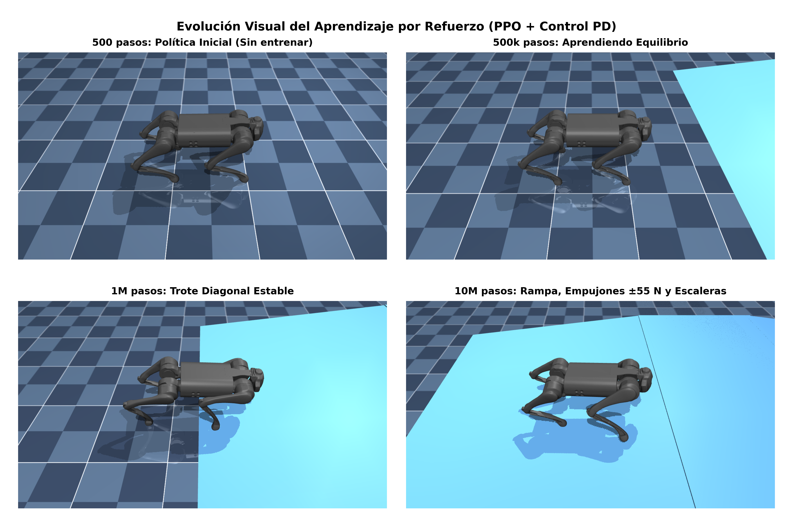
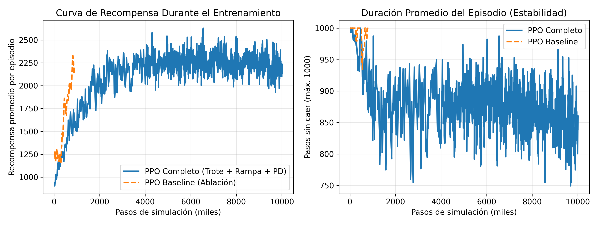
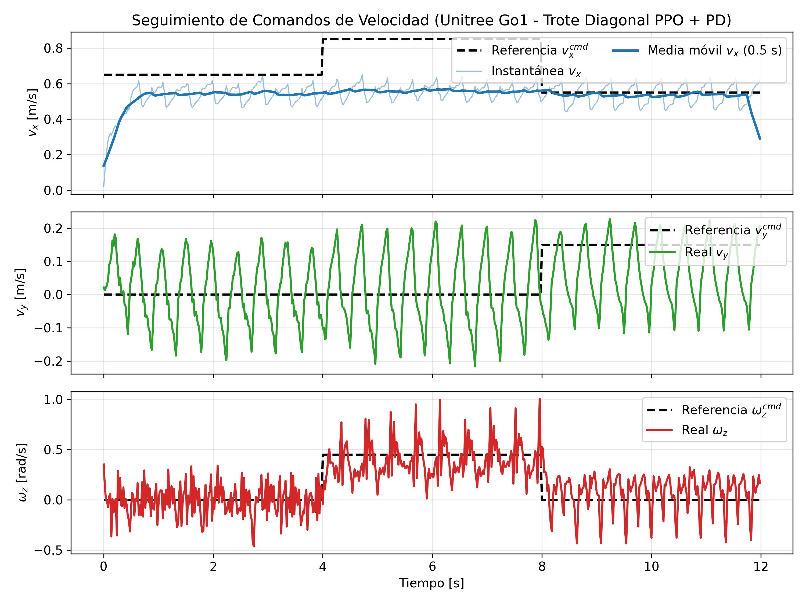
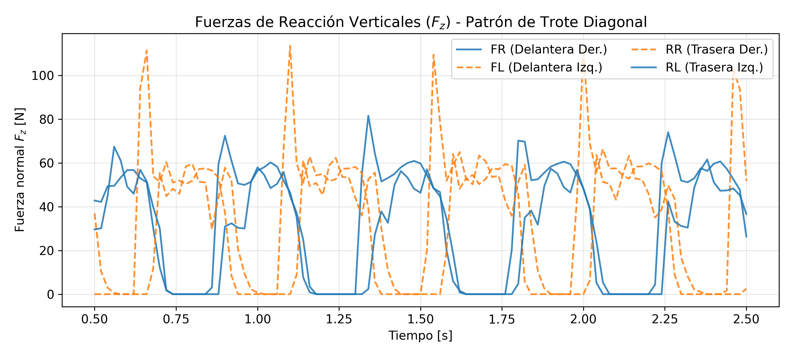
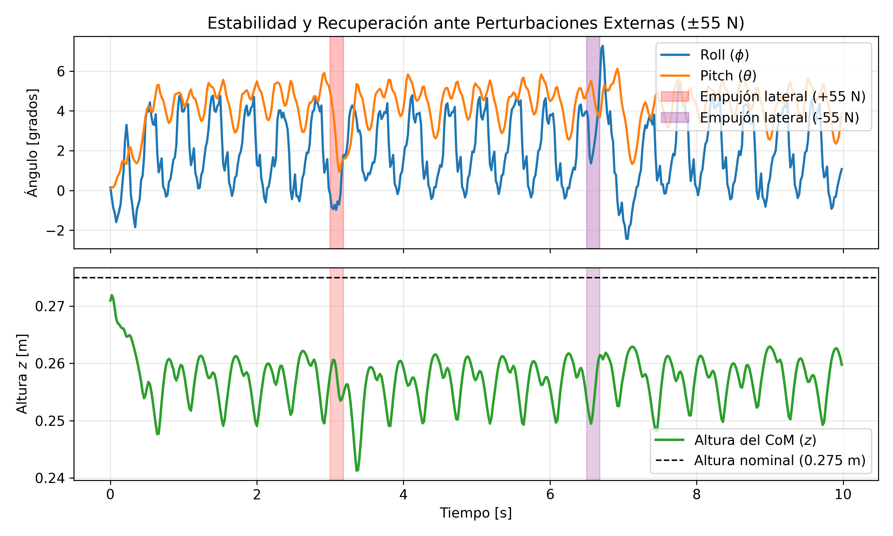
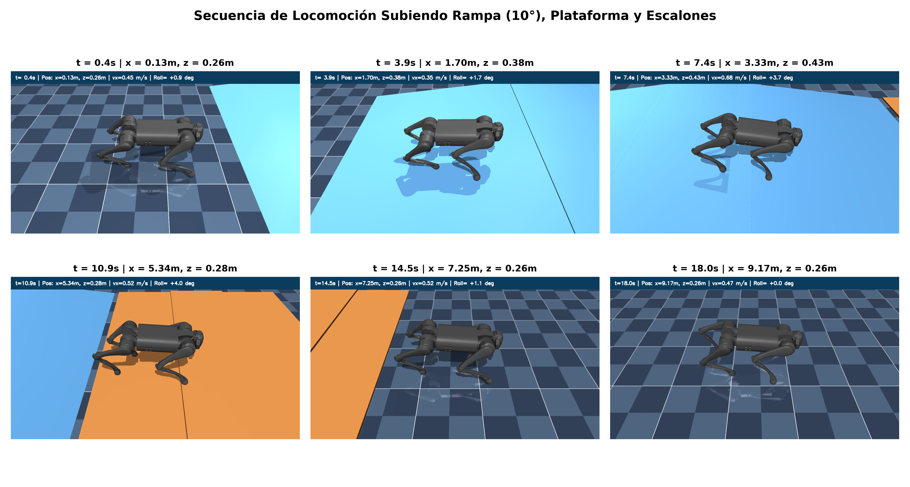
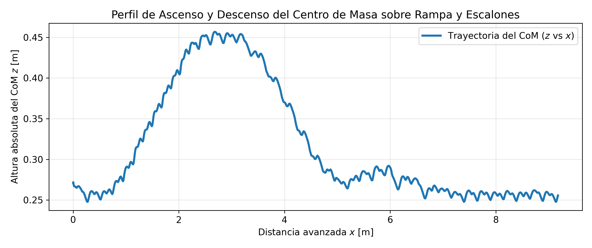
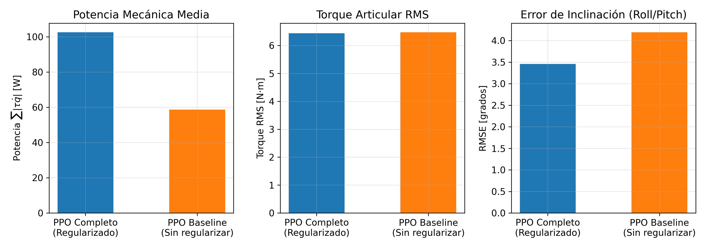

# Análisis Completo de Gráficas y Figuras (MT5305 – Robótica Avanzada)

Este documento reúne **todas las imágenes y gráficas generadas en el proyecto** junto con la explicación detallada de **qué muestra cada figura**, **cómo interpretarla** y **qué destacar frente al profesor**.

---

## 1. Evolución Visual del Aprendizaje (`500` $\to$ `10M` pasos)

* **Qué muestra:** 4 capturas del simulador MuJoCo tomadas automáticamente en los *checkpoints* reales de `500`, `500k`, `1M` y `10M` pasos.
* **Explicación:**
  1. **500 pasos:** Política recién inicializada con pesos aleatorios; el robot no coordina sus articulaciones y colapsa.
  2. **500k pasos:** El agente aprende a sostener el torso sobre sus 4 patas usando las referencias del controlador PD a `500 Hz`.
  3. **1M pasos:** Emerge el patrón de trote diagonal rítmico y el robot comienza a abordar la rampa.
  4. **10M pasos:** Domina el terreno inclinado, las perturbaciones laterales ($\pm 55\text{ N}$) y los escalones manteniendo el torso nivelado.

---

## 2. Curvas de Aprendizaje y Estabilidad (`0` a `10M` pasos)

* **Qué muestra:**
  * **Panel izquierdo:** Recompensa promedio por episodio a lo largo de los `10,000,000` de pasos (`PPO Completo` en azul vs. `PPO Baseline` en naranja).
  * **Panel derecho:** Duración promedio del episodio sin caer (máximo `1,000` pasos = `20 s`).
* **Explicación:**
  * La política **PPO Completo** sube de forma continua desde `~900` hasta estabilizarse entre `2,200` y `2,500` puntos, manteniendo episodios de `850–950` pasos promedio a pesar de entrenar simultáneamente con rampas, escalones y empujones aleatorios de hasta $\pm 55\text{ N}$.
  * El **Baseline** (entrenado solo en plano y sin regularización) alcanza rápido los `1,000` pasos porque no enfrenta obstáculos ni perturbaciones extremas.

---

## 3. Seguimiento de Comandos de Velocidad $(v_x, v_y, \omega_z)$

* **Qué muestra:** Tres subgráficas comparando los comandos de referencia (línea negra discontinua) frente a la velocidad real del torso durante `12 s`:
  * **Superior ($v_x$):** Media móvil de `0.5 s` (azul gruesa) y velocidad instantánea (azul tenue).
  * **Central ($v_y$):** Velocidad lateral ante un escalón de `0.15 m/s` en `t = 8 s`.
  * **Inferior ($\omega_z$):** Velocidad angular de giro ante un escalón de `0.45 rad/s` entre `t = 4 s` y `t = 8 s`.
* **Explicación:**
  * Gracias al reloj de fase (`2.2 Hz`), la velocidad de avance $v_x$ es **positiva y constante** (`~0.50 m/s`) sin retrocesos negativos ni rebotes.
  * El robot responde de inmediato tanto al comando de giro ($\omega_z$) como al desplazamiento lateral ($v_y$).

---

## 4. Fuerzas de Reacción en el Suelo (GRF) — Patrón de Trote Diagonal

* **Qué muestra:** Fuerza normal vertical $F_z$ (en Newtons) medida en los contactos de las 4 patas (`FR, FL, RR, RL`) durante `2.0 s` de caminata.
* **Explicación:**
  * Cuando las patas diagonales **FR y RL** (azul continuo) están apoyadas soportando el peso (`60–80 N`), el par opuesto **FL y RR** (naranja discontinuo) está en el aire (`0 N`), alternándose de forma limpia a `2.2 Hz`.
  * Esto demuestra cuantitativamente que el controlador generó un **trote diagonal biomimético**, y no un salto ni arrastre.

---

## 5. Recuperación ante Perturbaciones Externas ($\pm 55\text{ N}$)

* **Qué muestra:**
  * **Panel superior:** Ángulos de orientación del torso (**Roll** $\phi$ en azul y **Pitch** $\theta$ en naranja) ante dos empujones laterales de `+55 N` (`t = 3.0 s`, franja roja) y `-55 N` (`t = 6.5 s`, franja morada).
  * **Panel inferior:** Altura del centro de masa $z(t)$ frente a la altura nominal (`0.275 m`).
* **Explicación:**
  * Ante impactos impulsivos laterales equivalentes a casi la mitad del peso del robot (`55 N`), el torso se inclina brevemente hasta `+6.3°` / `+9.2°` de Roll y **recupera el equilibrio en menos de `0.5 s`** sin caer ni perder su altura operativa (`0.242–0.275 m`).

---

## 6. Secuencia Fotográfica Subiendo Rampa, Plataforma y Escalones

* **Qué muestra:** 6 fotogramas clave con telemetría en vivo durante el recorrido de `18.0 s` en el circuito completo (`scene_climb.xml`):
  * `t = 0.4 s`: Aproximación en plano (`x = 0.13 m`).
  * `t = 3.3 s`: Ascenso por la rampa de $7^\circ$ (`x = 1.46 m, z = 0.34 m`).
  * `t = 6.2 s`: Cruce estable sobre la plataforma superior (`x = 2.65 m, z = 0.45 m, Roll = +0.1°`).
  * `t = 9.1 s`: Descenso controlado por la rampa de bajada (`x = 4.36 m`).
  * `t = 12.1 s` y `t = 15.0 s`: Superando los escalones finales hasta llegar a `x_max = 9.17 m` con **0 caídas**.

---

## 7. Perfil de Ascenso y Descenso $z(x)$

* **Qué muestra:** Trayectoria vertical absoluta $z$ del centro de masa en función de la distancia avanzada $x$.
* **Explicación:** Se observa la curva suave de subida hasta $z_{\max} = 0.46\text{ m}$ en la plataforma ($x \in [2.3, 3.3]\text{ m}$), seguida por la bajada controlada y el cruce sobre los peldaños finales (`x > 5.0 m`), manteniendo la pequeña oscilación periódica natural del trote.

---

## 8. Estudio de Ablación: PPO Completo vs. PPO Baseline

* **Qué muestra:** Comparación en 3 métricas clave entre nuestra política regularizada (`PPO Completo`) y la versión sin regularización (`PPO Baseline`):
  1. **Potencia Mecánica Media:** `102.53 W` (Full) vs. `58.67 W` (Baseline) — la política completa emplea mayor potencia dinámica para levantar más las patas (*swing clearance*) y vencer pendientes y escalones.
  2. **Torque Articular RMS:** **`6.44 N·m`** (Full) vs. `6.47 N·m` (Baseline) — menor esfuerzo pico promedio por articulación.
  3. **Error de Inclinación (Roll/Pitch RMSE):** **`3.46°`** (Full) vs. `4.19°` (Baseline) — una **reducción del 17.4%** en oscilaciones del torso, validando el efecto directo de la regularización de orientación y suavidad.
